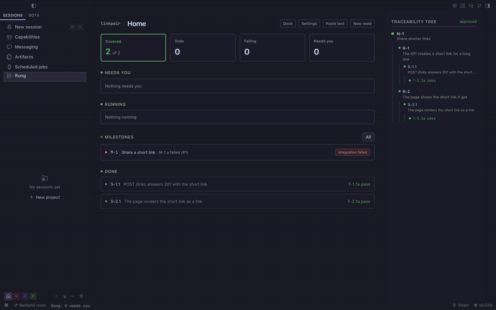

# Rung

**Tests, not the model, decide when agent work is done.**


Rung is a Hermes Agent plugin. You write a need, break it into requirements and specifications, and give
each specification tests. Agents do the work; a specification counts as done only when its tests pass,
and a deterministic check, not a model, says so. The ladder lives in a Desktop pane and a dock beside the
chat, and every agent sees the same ladder through Rung's tools.

## Install

```bash
hermes plugins install https://github.com/miguelangeloazevedo/rung --enable
hermes rung doctor
```

Restart the Desktop, then pick **Rung** in the sidebar and **Try the sample project**. The doctor ends with
`rung doctor: PASS`. Step-by-step checks, update and removal: [INSTALL.md](INSTALL.md).

## What you get



- **The ladder.** Need, requirement, specification, test, test execution. Text changes after approval
  make everything below it stale, so an old pass never counts for new words.
- **The done gate.** When a chat claims a specification (`rung_claim`) and tries to mark it done
  (`rung_report`, `kanban_complete`, or a todo item naming it), a `pre_tool_call` hook blocks the call
  and names the failing test. No model is asked.
- **Needs you.** Approvals, stale items, failed runs and blocked claims in one list, with a count in the
  status bar.
- **The dock.** Needs you, Running and the current need's ladder in a pane beside the chat.
- **Allocation.** Rung suggests which profile should carry a specification and lists every excluded
  profile with its reason: a missing required tool, too many runs at once, authorship of the work when
  the specification needs an independent carrier, or human only.
- **Develop runs.** Send a specification to a profile; Rung runs it in the project folder, attempt by
  attempt, until its tests pass or the attempts run out.
- **Goal gate.** `hermes rung check S-2.1` exits 0 only when that specification is released by its
  tests, so `/goal gate add hermes rung check S-2.1` stops a goal loop on tests.

## How it works

```text
 Need ── Requirement ── Specification ── Test ── Test execution
                             │             │
                   claim, develop run    command or manual,
                   by a Hermes profile   pass rule, approval
                             │             │
                             └── Rung check: released only when
                                 every test under it passes
                                 on the current text
                                         │
          pre_tool_call done gate ◄──────┤
          hermes rung check (goal gate) ◄┤
          Desktop pane and dock ◄────────┘
```

One local SQLite store holds the ladder. The engine is plain Python: structure, links, staleness,
coverage, execution history and allocation are computed, not inferred. Models only draft text when you
ask them to and do the development work.

| Surface | What it is |
| --- | --- |
| Desktop pane | Sidebar entry **Rung**: projects, ladder, editors, runs, read-out |
| Dock | Pane beside the chat (command palette: **Rung dock**) |
| Agent tools | `rung_status`, `rung_propose`, `rung_check`, `rung_run_tests`, `rung_claim`, `rung_report` |
| Hook | `pre_tool_call`: the done gate |
| CLI | `hermes rung check, status, tree, run, send, claims, readout, doctor, demo` |
| Slash command | `/rung`, `/rung check <SPEC>` |

Agents can propose and report; only a person approves text, tests and manual results.

## Safety and data

- **Store.** Everything Rung records is in `$HERMES_HOME/plugin-data/rung/`. A profile without a store
  of its own uses its root home's ladder. Removing the plugin leaves the store; delete that folder to
  remove the data.
- **Project folders.** Rung reads the folders you name for your projects, and test commands and develop
  runs work inside them. Nothing else on disk is read or changed.
- **Shell commands.** A command test runs the command you wrote, after you approve it, in the project
  folder, with a timeout and an output limit.
- **Hermes child runs.** A develop run, and drafting by a profile when you choose it, start
  `hermes -p <profile> chat -Q -q` in the project folder. That chat uses the profile's own model, tools
  and credentials, under Hermes's approval rules for single-query sessions (`approvals.single_query_mode`,
  deny by default). Rung never turns approvals off for it.
- **Background processes.** Each develop run is a supervised runner process that ends when the run
  finishes or you cancel it.
- **The hook.** Read only, no model call; if it cannot read the store it lets the call through and the
  doctor reports the store.
- **Network and credentials.** Rung itself makes no network calls, stores no credentials and sends no
  telemetry.

## Limits

- One machine: the store is local, not shared between computers.
- A specification is only as good as its tests. Rung makes the tests the stop condition; it does not
  judge whether they test the right thing. Manual tests and their approval stay with a person.
- Develop runs need a Hermes profile with a working model. The sample project runs without one.
- Hermes `0.23.0` or newer. Tested on macOS.

## Changelog

- **1.0.0.** The ladder, Needs you, staleness, test executions and defects, develop runs, allocation with
  required tools, runs at once, independence and human-only filters, claims and the done gate, the
  dock, the goal gate, the read-out, the doctor and the sample project.

## License

MIT, see [LICENSE](LICENSE).
